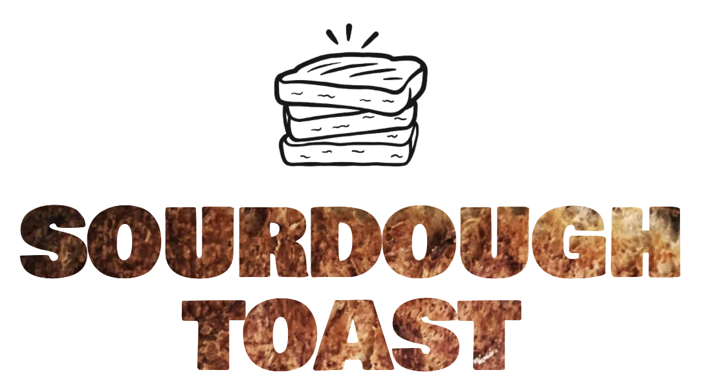

A plain JavaScript toast notification library inspired by [Sonner](https://sonner.emilkowal.ski).

[Demo and usage](https://sourdough-toast.vercel.app/example)

## Installation

```sh
npm install sourdough-toast
```

## Usage

Import the CSS and boot the toaster once, then call `toast` from anywhere:

```js
import { boot, toast } from "sourdough-toast";
import "sourdough-toast/sourdough-toast.css";

window.addEventListener("DOMContentLoaded", () => boot());

toast("Saved");
```

There is one toaster: `boot(options)` is a no-op if one is already live, and `destroy()` tears it down so a differently-configured one can boot.

## Toasts

Every variant takes a title and an optional options object, and returns the toast's id:

```js
toast("Plain toast");
toast.success("It worked");
toast.info("FYI");
toast.warning("Careful");
toast.error("It broke");
toast.message({ title: "Saved", description: "Your changes are safe." });

const id = toast("Working…", { persist: true });
toast.dismiss(id);
```

Per-toast options:

| Option        | Description                                                              |
| ------------- | ------------------------------------------------------------------------ |
| `type`        | `"success"`, `"info"`, `"warning"`, or `"error"` — sets the icon         |
| `description` | Smaller text below the title                                             |
| `duration`    | Milliseconds before auto-dismiss (default from the toaster)              |
| `persist`     | Never auto-dismisses, doesn't count toward `maxToasts`, gets a close button |
| `closeButton` | Show a close button on this toast                                        |
| `html`        | Render `description` as HTML                                             |

With `html: true`, elements inside the description with a `data-toast-dismiss` attribute dismiss the toast when clicked:

```js
toast("Update ready", {
  description: `<button data-toast-dismiss>Later</button>`,
  html: true,
  persist: true,
});
```

> [!WARNING]
> `html: true` injects the description via `innerHTML` without sanitization. Never pass user-provided content — it's an XSS vector.

Toasts can also be dismissed by swiping them toward their screen edge — down when positioned at the bottom, up when at the top.

## Options

`boot(options)` accepts:

| Option              | Default    | Description                                    |
| ------------------- | ---------- | ---------------------------------------------- |
| `maxToasts`         | `3`        | Visible toasts (persisted toasts don't count)  |
| `duration`          | `4000`     | Auto-dismiss timeout in ms                     |
| `width`             | `356`      | Toast width in px                              |
| `gap`               | `14`       | Gap between expanded toasts in px              |
| `theme`             | `"light"`  | `"light"` or `"dark"`                          |
| `viewportOffset`    | `32`       | Distance from the viewport edge in px          |
| `expandedByDefault` | `false`    | Show toasts expanded instead of stacked        |
| `yPosition`         | `"bottom"` | `"top"` or `"bottom"`                          |
| `xPosition`         | `"right"`  | `"left"` or `"right"`                          |
| `closeButton`       | `false`    | Show close buttons on all toasts               |
| `richColors`        | `false`    | Colored backgrounds for typed toasts           |

## Theming

Besides the `theme` option, toasts read the `--sourdough-background`, `--sourdough-foreground`, and `--sourdough-border-color` custom properties on `[data-sourdough-toaster]`, and `--mobile-offset` controls the inset on small screens.

## License

MIT
